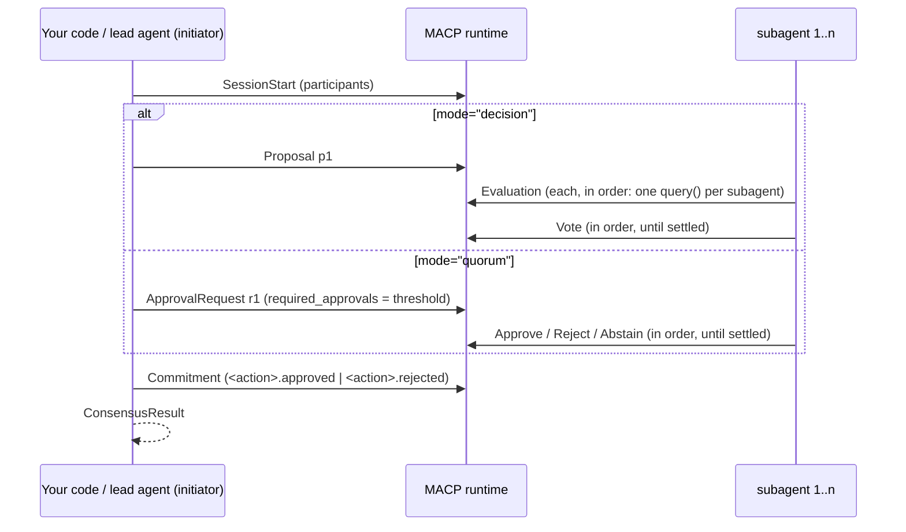

# claude-agent-sdk-macp

Let your **Claude Agent SDK subagents make a binding decision** in a few lines.

You already describe subagents as `AgentDefinition`s. `macp_consensus` turns each one into a
participant in a [MACP](https://multiagentcoordinationprotocol.io) Decision (or Quorum) session
on the MACP runtime: every subagent evaluates the proposal from its own role, they vote, the
outcome is committed, and you get the Commitment back. Anyone can check the outcome later. The
runtime records it, `commitment_hash` identifies it, and a decision receipt for it takes one call.

```bash
pip install claude-agent-sdk-macp
```

The TypeScript twin is
[`@multiagentcoordinationprotocol/claude-agent-sdk`](https://github.com/multiagentcoordinationprotocol/macp-sdk-typescript/tree/main/integrations/claude-agent-sdk).
It has the same options, the same flow and the same result, in camelCase.

## Quick start

```python
import asyncio

from claude_agent_sdk import AgentDefinition
from macp_sdk import AuthConfig, MacpClient

from claude_agent_sdk_macp import consensus_receipt, macp_consensus

agents = {
    "security": AgentDefinition(description="Security review", prompt="You review security..."),
    "sre": AgentDefinition(description="Reliability review", prompt="You review reliability..."),
    "product": AgentDefinition(description="Product review", prompt="You review user impact..."),
}

client = MacpClient(target="127.0.0.1:50051", allow_insecure=True,
                    auth=AuthConfig.for_dev_agent("coordinator"))

result = asyncio.run(macp_consensus(client, "ship v2 to all users", agents=agents))
result["outcome"]          # "approve" | "reject"
result["commitment_hash"]  # "sha256:…"
receipt = consensus_receipt(result, issuer="did:web:example.com")
```

Or let a lead agent call the vote itself, as a tool:

```python
from claude_agent_sdk import ClaudeAgentOptions, query

from claude_agent_sdk_macp import macp_consensus_server

options = ClaudeAgentOptions(
    model="claude-opus-5-5",
    mcp_servers={"macp": macp_consensus_server(client, agents=agents)},
    allowed_tools=["mcp__macp__consensus"],
)
async for message in query(prompt="Should we ship v2? Put it to the reviewers.", options=options):
    ...
```

A local runtime for development:

```bash
docker run -d -p 50051:50051 -e MACP_ALLOW_INSECURE=1 \
  ghcr.io/multiagentcoordinationprotocol/macp-runtime:0.9.0
```

## How a vote runs



- **The initiator** is the client's identity. It opens the session, sends the proposal and commits.
  It never votes and is not counted.
  - In Decision mode it is listed as the first session participant, because the runtime accepts
    a `Proposal` only from a declared participant.
  - In Quorum mode it is not a session participant.
- **Subagents**
  - `agents` is a dict of participant id to `AgentDefinition`, the same dict you give
    `ClaudeAgentOptions(agents=...)`. They evaluate and vote in insertion order.
  - Each sends under its own auth, `AuthConfig.for_dev_agent(id)`. For bearer tokens in
    production, pass `participants=` instead (below).
- **Evaluation**
  - Each evaluation is one `query()` run. The prompt is the proposal as JSON:
    `{"proposal_id", "option", "rationale", "details", "mode"}`.
  - The subagent answers through a JSON schema (`EVALUATION_SCHEMA`) with a `recommendation`
    (`APPROVE`, `REVIEW`, `BLOCK` or `REJECT`), a `confidence` from 0 to 1, and a one-sentence
    `reason`.
- **Ballots**
  - `APPROVE` → approve; `REVIEW` → abstain; `REJECT` or `BLOCK` → reject.
- **Settlement**
  - Approved once `threshold` subagents approve. The default threshold is a strict majority,
    `n // 2 + 1`.
  - Rejected as soon as approval is out of reach.
  - The initiator commits at once, so the remaining subagents never vote.
- **Errors**
  - If anything fails after the session opens, the session is cancelled and the error re-raised.
    This covers a NACK, a transport error, a failed `query()` run, and `POLICY_DENIED` on commit.
  - The blocking gRPC calls and each subagent's `query()` run in a worker thread, so
    `macp_consensus` does not block your event loop.

## `macp_consensus`

`await macp_consensus(client, proposal, *, agents=None, participants=None, ...)`

| Option | Default | |
|---|---|---|
| `client` | required | `MacpClient` authenticated as the initiator |
| `proposal` | required | `str`, or `{"option", "rationale"?, "details"?}` |
| `agents` | | `dict[str, AgentDefinition]`, in voting order |
| `participants` | | `ConsensusParticipant(id, evaluator, auth=None, voter=None)` list. Pass this or `agents`, not both |
| `mode` | `"decision"` | `"decision"` or `"quorum"` |
| `policy` | `"policy.default"` | a registered `policy_version` (RFC-MACP-0012) |
| `threshold` | `n // 2 + 1` | approvals required, `1..n` |
| `ttl_ms` | `60000` | session TTL |
| `action` | `"macp.consensus"` | committed as `<action>.approved` / `<action>.rejected` |
| `initiator` | from the client's auth | the initiator's agent id, needed with a bearer token that has no `sender_hint` |

It returns a `ConsensusResult`:

```python
{
    "outcome": "approve",                       # or "reject"
    "session_id": "5a5b7088-…",
    "commitment_hash": "sha256:65f0e9bc…",     # RFC-MACP-0013 macp-commitment-hash/1
    "mode": "macp.mode.decision.v1",
    "commitment": {                             # RFC-MACP-0013 §3 projection, plain JSON
        "commitment_id": "…", "action": "macp.consensus.approved",
        "authority_scope": "macp.consensus", "reason": "2/3 approvals (threshold 2)",
        "mode_version": "1.0.0", "policy_version": "policy.default",
        "configuration_version": "config.default", "outcome_positive": True,
    },
    "approvals": 2,
    "threshold": 2,
}
```

## `claude_evaluator`

`claude_evaluator(agent, *, model=None, max_turns=None, options=None)` is the
`EvaluationStrategy` that `agents=` builds for each subagent. Use it directly with
`participants=` to set auth, a custom `VotingStrategy`, or mix in non-Claude evaluators:

```python
from claude_agent_sdk_macp import ConsensusParticipant, claude_evaluator

participants = [
    ConsensusParticipant("security", claude_evaluator(agents["security"]),
                         auth=AuthConfig.for_bearer(token, expected_sender="security")),
    ConsensusParticipant("rules", lambda proposal, info: {"recommendation": "APPROVE",
                                                         "confidence": 1, "reason": "in policy"}),
]
```

Each evaluation's `ClaudeAgentOptions` come from the `AgentDefinition`:

| Field | Value |
|---|---|
| `system_prompt` | `agent.prompt`, then `EVALUATOR_INSTRUCTIONS` |
| `model` | `agent.model` (`"inherit"` counts as unset), else `model=`, else `claude-opus-5-5` |
| `max_turns` | `agent.maxTurns`, else `max_turns=`, else `4` |
| `tools` | `agent.tools`, else none |
| `disallowed_tools`, `effort` | from the `AgentDefinition` |
| `output_format` | `{"type": "json_schema", "schema": EVALUATION_SCHEMA}` |
| `setting_sources` | `[]`, and no session persistence |

`options=` (a dict of `ClaudeAgentOptions` fields) is applied last and wins. Use it for `cwd`,
`env`, `permission_mode` and the like.

- The structured output is read first, then the result text (a Markdown code fence is fine).
  An answer that cannot be read becomes `REVIEW` with confidence `0` and reason
  `"unparseable model output"`. That is an abstention, so a confused subagent cannot approve
  anything.
- A run that fails (an error result such as `error_max_turns`, or no result at all) raises
  `MacpSdkError`, and the session is cancelled.

## `macp_consensus_server`

`macp_consensus_server(client, *, agents=None | participants=None, ..., on_result=None)` takes the
same options as `macp_consensus` and returns an in-process MCP server named `macp` with one tool,
`consensus` ("Put a decision to a binding MACP vote among the configured subagents"). The lead
agent sees it as `mcp__macp__consensus`.

- Its input is `{"option": str, "rationale"?: str, "details"?: object}`.
- It returns the `ConsensusResult` as JSON text.
- A failure comes back as an error result, `consensus failed: <message>`, so the lead agent can
  read it.
- `on_result(result)`, sync or async, sees every committed result. Use it to store the result or
  build a receipt. If it raises, the tool returns an error saying the outcome was committed
  anyway: `consensus committed <outcome> (session <id>) but on_result failed: <message>`.
- Settings are checked when the server is built, not on the first call.
- `consensus_tool(...)` returns the bare tool, to mount next to your own tools in one
  `create_sdk_mcp_server`.

## Decision receipts

`consensus_receipt(result, issuer=..., issued_at=None, signer=None)` returns an RFC-MACP-0013
Appendix A `macp-receipt/1` receipt. `issued_at` defaults to now, in `YYYY-MM-DDTHH:MM:SSZ` form.

- With no signer, `verify_receipt(receipt, {})` gives `integrity_only`.
- Pass `macp_sdk.ReceiptSigner(kid, private_key=<32-byte seed>)` for an Ed25519 attestation.
  It then verifies `attested` against your trusted keys.

## Examples

- [`examples/release_review.py`](examples/release_review.py)
  - Security, SRE and product subagents settle a checkout release through `macp_consensus`.
  - By default their `query()` is stubbed with canned answers, so it needs no key and gives the
    same result every run. The integration test runs it.
  - `--live` (with `ANTHROPIC_API_KEY`) has `claude-opus-5-5` do the reviewing.
- [`examples/lead_agent_review.py`](examples/lead_agent_review.py)
  - A `claude-opus-5-5` lead agent with only the `mcp__macp__consensus` tool. It puts the release
    to the same three subagents and reports the committed outcome.
  - Needs `ANTHROPIC_API_KEY`.

## Testing without a model

Every function takes `query=`, a stand-in for `claude_agent_sdk.query`
(`query(*, prompt, options)` returning an async iterator of messages). Yield a `ResultMessage`
with `structured_output={"recommendation": ..., "confidence": ..., "reason": ...}`, and no model is
called. The unit tests, the integration tests and the default example all work this way.

## Development

```bash
cd integrations/claude-agent-sdk
python -m venv .venv && .venv/bin/pip install -e "../..[receipts]" -e ".[dev]"
.venv/bin/pytest tests/unit --cov            # no runtime, no API key
MACP_RUNTIME_TARGET=127.0.0.1:50051 .venv/bin/pytest tests/integration
```

The package lives in the SDK repo but has its own version and release tag,
`claude-agent-sdk-macp-vX.Y.Z`. It pins `macp-sdk-python[receipts]>=0.19,<0.23` and
`claude-agent-sdk>=0.2,<0.3`.

## Other frameworks

- **LangGraph**: [`langgraph-macp`](../langgraph/), a graph node with the same engine.
- **OpenAI Agents SDK**: handoffs mapped to MACP Handoff mode. Deferred, and next.

## License

Apache-2.0
