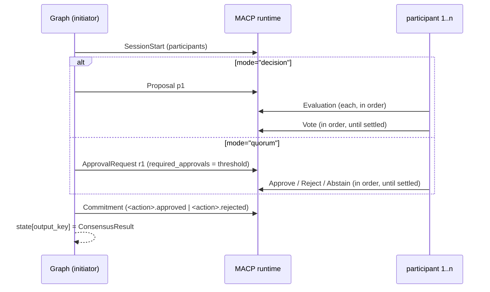

# langgraph-macp

Add a **binding multi-agent decision** to a LangGraph graph in a few lines.

`MacpConsensusNode` is a LangGraph node. It opens a [MACP](https://multiagentcoordinationprotocol.io)
Decision or Quorum session on the MACP runtime and lets each participant evaluate the proposal,
usually through its own LLM. It then has them vote, commits the outcome, and writes the
Commitment back into graph state. Anyone can check the committed outcome later: the runtime
records it, `commitment_hash` identifies it, and a decision receipt for it takes one call.

```bash
pip install langgraph-macp
```

The TypeScript twin is
[`@multiagentcoordinationprotocol/langgraph`](https://github.com/multiagentcoordinationprotocol/macp-sdk-typescript/tree/main/integrations/langgraph).
It has the same options, the same flow and the same state keys, in camelCase.

## Quick start

```python
from typing import TypedDict

from langchain_anthropic import ChatAnthropic
from langgraph.graph import END, START, StateGraph
from macp_sdk import AuthConfig, MacpClient

from langgraph_macp import (
    ConsensusParticipant, ConsensusResult, MacpConsensusNode, consensus_receipt, llm_evaluator,
)


class State(TypedDict, total=False):
    proposal: str
    macp: ConsensusResult  # declare the output key, or LangGraph drops it


client = MacpClient(target="127.0.0.1:50051", allow_insecure=True,
                    auth=AuthConfig.for_dev_agent("coordinator"))
model = ChatAnthropic(model="claude-opus-5-5")
consensus = MacpConsensusNode(client, [
    ConsensusParticipant("security", llm_evaluator(model, system_prompt="You review security...")),
    ConsensusParticipant("sre", llm_evaluator(model, system_prompt="You review reliability...")),
    ConsensusParticipant("product", llm_evaluator(model, system_prompt="You review user impact...")),
])

graph = StateGraph(State)
graph.add_node("consensus", consensus)
graph.add_edge(START, "consensus")
graph.add_edge("consensus", END)

final = graph.compile().invoke({"proposal": "ship v2 to all users"})
final["macp"]["outcome"]          # "approve" | "reject"
final["macp"]["commitment_hash"]  # "sha256:…"
receipt = consensus_receipt(final["macp"], issuer="did:web:example.com")
```

A local runtime for development:

```bash
docker run -d -p 50051:50051 -e MACP_ALLOW_INSECURE=1 \
  ghcr.io/multiagentcoordinationprotocol/macp-runtime:0.9.0
```

## How the node runs a session



- **The initiator** is the client's identity. It opens the session, sends the proposal and commits.
  It never votes and is not counted.
  - In Decision mode it is listed as the first session participant, because the runtime accepts
    a `Proposal` only from a declared participant.
  - In Quorum mode it is not a session participant.
- **Participants** each send under their own auth. The default is
  `AuthConfig.for_dev_agent(id)`; pass `auth=AuthConfig.for_bearer(...)` in production.
- **Evaluation**
  - An evaluator is an SDK `EvaluationStrategy` (`evaluate(proposal, session_info)`), or a plain
    function with that signature.
  - It returns an `EvaluationResult`, or a mapping with `recommendation`, `confidence` and `reason`.
  - `recommendation` must be one of `APPROVE`, `REVIEW`, `BLOCK` or `REJECT` (case-insensitive).
    `ABSTAIN` is read as `REVIEW`. Anything else raises.
  - `proposal` is
    `{"proposal_id", "option", "rationale", "details", "mode"}`.
- **Ballots**
  - `APPROVE` → approve; `REVIEW` → abstain; `REJECT` or `BLOCK` → reject.
  - In Decision mode a participant may set `voter=`, any SDK `VotingStrategy`, to vote differently
    from its own recommendation.
- **Settlement**
  - Approved once `threshold` participants approve. The default threshold is a strict majority,
    `n // 2 + 1`.
  - Rejected as soon as approval is out of reach.
  - The initiator commits at once, so the remaining participants never vote.
- **Errors**
  - If anything fails after the session opens, the node cancels the session and re-raises.
    This covers a NACK, a transport error, an evaluator exception, and `POLICY_DENIED` on commit.
  - Nothing is written to state.
- **Sync and async.** The node is a `RunnableLambda`, so it works under `invoke` and `ainvoke`.
  The async path runs the blocking gRPC calls in a worker thread.

## Options

| Option | Default | |
|---|---|---|
| `client` | required | `MacpClient` authenticated as the initiator |
| `participants` | required | `ConsensusParticipant(id, evaluator, auth=None, voter=None)`, in voting order |
| `mode` | `"decision"` | `"decision"` or `"quorum"` |
| `policy` | `"policy.default"` | a registered `policy_version` (RFC-MACP-0012) |
| `threshold` | `n // 2 + 1` | approvals required, `1..n` |
| `proposal` | `state["proposal"]` | `state -> str \| {"option", "rationale"?, "details"?}` |
| `output_key` | `"macp"` | state key written |
| `ttl_ms` | `60000` | session TTL |
| `action` | `"macp.consensus"` | committed as `<action>.approved` / `<action>.rejected` |
| `initiator` | from the client's auth | the initiator's agent id, needed with a bearer token that has no `sender_hint` |

## What lands in state

```python
{
    "outcome": "approve",                       # or "reject"
    "session_id": "5a5b7088-…",
    "commitment_hash": "sha256:65f0e9bc…",     # RFC-MACP-0013 macp-commitment-hash/1
    "mode": "macp.mode.decision.v1",
    "commitment": {                             # RFC-MACP-0013 §3 projection, plain JSON
        "commitment_id": "…", "action": "macp.consensus.approved",
        "authority_scope": "macp.consensus", "reason": "2/3 approvals (threshold 2)",
        "mode_version": "1.0.0", "policy_version": "policy.default",
        "configuration_version": "config.default", "outcome_positive": True,
    },
    "approvals": 2,
    "threshold": 2,
}
```

`commitment` is plain data, so LangGraph checkpointers can store it.

## Decision receipts

`consensus_receipt(result, issuer=..., issued_at=None, signer=None)` returns an RFC-MACP-0013
Appendix A `macp-receipt/1` receipt. `issued_at` defaults to now, in `YYYY-MM-DDTHH:MM:SSZ` form.

- With no signer, `verify_receipt(receipt, {})` gives `integrity_only`.
- Pass `macp_sdk.ReceiptSigner(kid, private_key=<32-byte seed>)` for an Ed25519 attestation.
  It then verifies `attested` against your trusted keys.

## LLM evaluators

`llm_evaluator(chat_model, system_prompt=None)` turns any LangChain chat model into an evaluator.

- It asks the model for `{"recommendation", "confidence", "reason"}` as JSON. A Markdown code
  fence around the answer is accepted.
- An answer it cannot read becomes `REVIEW` with confidence `0` and reason
  `"unparseable model output"`. That is an abstention, so a confused model cannot approve
  anything.
- Tests and the default example use LangChain's `FakeListChatModel` with canned answers, so they
  need no API key.

## Examples

- [`examples/fraud_review_graph.py`](examples/fraud_review_graph.py)
  - A fraud-review graph, shaped like macp-playground's LangGraph worker.
  - It scores signals, then three specialists (fraud, growth, compliance) settle the transaction
    through the node, and the graph routes on the outcome.
  - Its LLMs are stubs, so it needs no key and gives the same result every run. The integration
    test runs it.
- [`examples/real_llm_review.py`](examples/real_llm_review.py)
  - The same graph with `claude-opus-5-5` specialists.
  - Needs `pip install "langgraph-macp[examples]"` (adds `langchain-anthropic`) and
    `ANTHROPIC_API_KEY`.

## Development

```bash
cd integrations/langgraph
python -m venv .venv && .venv/bin/pip install -e "../..[receipts]" -e ".[dev]"
.venv/bin/pytest tests/unit --cov            # no runtime needed
MACP_RUNTIME_TARGET=127.0.0.1:50051 .venv/bin/pytest tests/integration
```

The package lives in the SDK repo but has its own version and release tag, `langgraph-macp-vX.Y.Z`.
It pins `macp-sdk-python[receipts]>=0.19,<0.21`.

## Other frameworks

- **Claude Agent SDK**: subagents voting through Decision mode, in [`claude-agent-sdk-macp`](../claude-agent-sdk/).
- **OpenAI Agents SDK**: handoffs mapped to MACP Handoff mode. Deferred, and next.

## License

Apache-2.0
